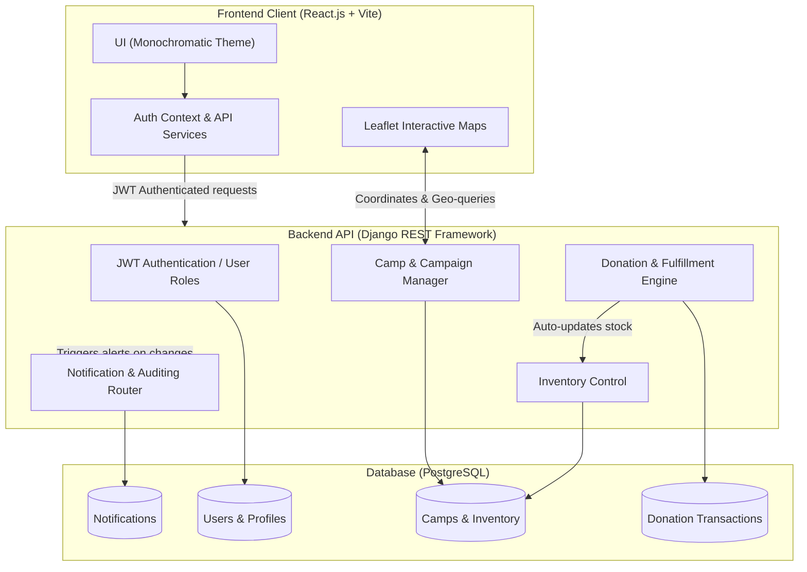
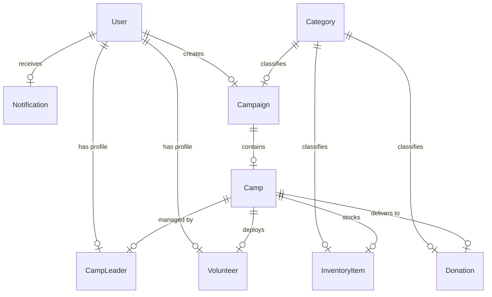

# 🌐 ReliefNet — Community Relief & Campaign Management System

ReliefNet is a production-grade, state-of-the-art disaster relief coordination and shelter resource management system. Designed to bridge the gap between disaster relief administrators, field personnel (camp leaders), volunteers, and donors, it features a decoupled architecture composed of a high-performance **Python/Django REST Framework** backend and a responsive, modern **React.js** frontend client styled using a premium monochromatic design system and Inter typography.

---

## 🛠️ System Architecture

ReliefNet operates as a unified platform where actions in one hub dynamically propagate to other components. The architecture ensures strict role separation, automatic inventory adjustments, Leaflet-mapped location rendering, and real-time activity notifications.



---

## 📂 Project Directory Structure

```
ReliefNet/
├── docker-compose.yml         # Container orchestration manager
├── README.md                  # Comprehensive system documentation
├── backend/
│   ├── Dockerfile             # Django service image builder
│   ├── requirements.txt       # Python backend dependencies
│   ├── manage.py              # Django CLI manager
│   ├── populate_data.py       # DB seed script for mock environments
│   ├── reliefnet_backend/     # Main project settings & routing configuration
│   ├── accounts/              # Custom user role registries & endpoints
│   ├── campaigns/             # Relief campaigns CRUD & unified search index
│   ├── camps/                 # Shelter camp locations & coordinate managers
│   ├── categories/            # Inventory categorization schema
│   ├── inventory/             # Dynamic item quantities, units, and levels
│   ├── donations/             # General donor tracking & fulfillment pipelines
│   └── notifications/         # Automated activity logs, alerts, and badges
└── frontend/
    ├── Dockerfile             # Multi-stage static builder & Nginx host
    ├── package.json           # Node project specifications
    ├── vite.config.js         # Build pipeline options
    └── src/
        ├── components/        # Reusable map widgets, navbar, footer, login
        ├── context/           # React Global Context (AuthContext session manager)
        ├── pages/             # Monochrome-themed dashboards, history, registries
        └── services/          # API Axios interceptor (JWT tokens & auto-refresh)
```

---

## 📊 Database Schema (ER Diagram)

Below is the entity-relationship representation of all core system modules:



### Entity Specifications

1. **User**: Inherits Django's base `AbstractUser`. Includes custom `role` choices (`SUPER_ADMIN`, `CAMP_LEADER`, `VOLUNTEER`), status indicators, contact details, and a `must_change_password` flag for secure credential handovers.
2. **Campaign**: Holds event metadata (e.g. Flood relief, earthquake aid). Links directly to a Category classification and tracks fundraising status and deadlines.
3. **Camp**: Holds coordinate geometry (latitude/longitude), maps back to an active Campaign, and contains references to a single `User` as its Camp Leader.
4. **InventoryItem**: Dynamic shelter stocks linked to Categories. Quantities must remain non-negative and are adjusted automatically by donation logs.
5. **Volunteer / CampLeader**: Profiles linked via a `OneToOneField` relation to their respective base Users. Handles lifecycle approval transitions (`PENDING`, `APPROVED`, `REJECTED`, `ASSIGNED`).
6. **Donation**: Tracks aid offers. Transitioning a donation status to `COMPLETED` automatically increment/updates the corresponding `InventoryItem` quantities in the camp.

---

## 👑 Role-Based Workflows

ReliefNet enforces strict separation of concerns using three core access portals:

### 1. Super Admin Portal
* **Campaign & Camp Management**: Create new disaster relief campaigns, define target parameters, pin camp locations on interactive Leaflet maps, and assign coordinates.
* **Camp Leader Onboarding**: 
  - Review incoming applications for Camp Leaders.
  - Approve applications to auto-generate secure temporary credentials (username and randomized password).
  - Retrieve credentials directly from the leader's profile detail view under approvals.
  - Deploy/assign leaders to camps, automatically cleaning up any previous assignments (one leader per camp constraint).
* **Volunteer Deployment**: Manage volunteer applications, approve them, and deploy them to target camps via direct dropdown options or unassign/recall them as needed.
* **Donations Auditing**: Monitor aid transactions and approve incoming physical goods.

### 2. Camp Leader Portal
* **Inventory Tracking**: Manage live stocks inside the assigned camp (Add, Edit, Delete items).
* **Donation Log View**: View donations targeted for their specific camp location.
* **Local Notifications**: Receive instant notification cards when assigned to a camp, unassigned, or when new inventory is processed.

### 3. Volunteer & Public Portal
* **Campaign Explorer**: Browse campaigns and view camp details, coordinates, and contact details.
* **Volunteer Application**: Apply to help in a campaign. Once approved by the Admin, volunteers are deployed to a specific camp and receive alerts detailing their assignment.
* **Donor Support**: Offer cash or physical items to any active campaign, selecting which camp gets the delivery.

---

## ⚡ Setup & Installation Guide

### 1. Prerequisites
Ensure the following utilities are installed:
- **Python 3.11+**
- **Node.js (LTS)**
- **PostgreSQL** (or configure sqlite3 in settings for testing)
- **Docker & Docker Compose** (optional)

---

### 2. Manual Development Setup

#### A. Run Backend
1. Navigate to the `backend/` directory.
2. Create and activate a python virtual environment:
   ```bash
   python -m venv venv
   # On Windows (PowerShell):
   venv\Scripts\Activate.ps1
   # On macOS/Linux:
   source venv/bin/activate
   ```
3. Install dependencies:
   ```bash
   pip install -r requirements.txt
   ```
4. Run migrations:
   ```bash
   python manage.py migrate
   ```
5. Seed database with mock data (including the default Super Admin `admin` / `admin123`):
   ```bash
   python populate_data.py
   ```
6. Start development server:
   ```bash
   python manage.py runserver
   ```
   *The Django API is accessible at: `http://localhost:8000/api/`*

#### B. Run Frontend
1. Navigate to the `frontend/` directory.
2. Install npm modules:
   ```bash
   npm install
   ```
3. Start the Vite development server:
   ```bash
   npm run dev
   ```
   *The React UI is accessible at: `http://localhost:5173/`*

---

### 3. Docker Compose Orchestration (Recommended)

To run the entire stack (PostgreSQL DB, Django REST API, React client) in containerized mode with hot-reloading:

```bash
# In the root project directory:
docker compose up --build
```
- **React Client**: `http://localhost:5173/`
- **Django REST API**: `http://localhost:8000/`
- **PostgreSQL Container**: Internal connection on port `5432`

---

## 📖 API Documentation Reference

All API calls are prefixed with `/api/` and require JWT headers (`Authorization: Bearer <token>`) except public endpoints.

### Authentication Endpoints

| Endpoint | Method | Payloads / Parameters | Description |
| :--- | :--- | :--- | :--- |
| `auth/login/` | `POST` | `{ "username": "...", "password": "..." }` | Standard JWT token generator. Returns access and refresh keys. |
| `auth/token/refresh/` | `POST` | `{ "refresh": "..." }` | Refreshes expired access tokens. |
| `auth/logout/` | `POST` | `{ "refresh": "..." }` | Blacklists refresh token. |
| `auth/me/` | `GET` | Headers: `Authorization: Bearer <token>` | Returns profile information of active session. |

### Core Registry & Ops Endpoints

| Endpoint | Method | Supported Query Params | Description |
| :--- | :--- | :--- | :--- |
| `campaigns/` | `GET`, `POST` | `?category=1`, `?status=ACTIVE`, `?ordering=-created_at`, `?search=flood` | Read campaigns or create a new campaign. Supports date validations. |
| `camps/` | `GET`, `POST` | `?campaign=1`, `?status=ACTIVE`, `?ordering=name`, `?search=guwahati` | Read/Write shelter camps. Maps Leaflet geo-points. |
| `camps/<id>/assign-leader/` | `POST` | `{ "full_name": "...", "age": "...", "email": "...", "phone": "...", "gov_id": "...", "address": "..." }` | Directly assigns a newly created leader account to a camp. |
| `leaders/` | `GET`, `PATCH` | `?status=PENDING`, `?search=name` | Read/Update leader profiles. Approving generates temp credentials. |
| `inventory/` | `GET`, `POST` | `?camp=1`, `?category=3`, `?ordering=-quantity` | Camp leaders manage dynamic food, medical, and clothes stocks. |
| `volunteers/` | `GET`, `PATCH` | `?status=PENDING`, `?search=volunteer_name` | Public volunteer registries & admin approvals/deployments. |
| `donations/` | `GET`, `POST` | `?camp=1`, `?status=PENDING`, `?ordering=-donation_date` | Accept donations. Setting status `COMPLETED` auto-increases camp stock. |
| `notifications/` | `GET` | `?is_read=false` | Real-time notifications and system badges. |
| `dashboard/stats/`| `GET` | None | Unified dashboard stats endpoint used for analytics graphs. |
| `search/` | `GET` | `?q=query` | Multi-table live unified search bar. |

---

## 🛠️ Production Deployment Guide

When taking ReliefNet to a live server:

1. **Environment Variables**:
   Update `DEBUG = False` and define `ALLOWED_HOSTS` inside backend env settings. Configure strong database passwords.
2. **Collect Static Files**:
   ```bash
   python manage.py collectstatic --no-input
   ```
3. **Configure Nginx**:
   Set up Nginx as a reverse proxy for ports `80` / `443` mapping requests to Gunicorn (`http://127.0.0.1:8000`) for API requests and serving raw build outputs (`frontend/dist/`) directly.
4. **SSL Configuration**:
   Secure endpoints with Let's Encrypt certificates to encrypt JWT payloads transit.
